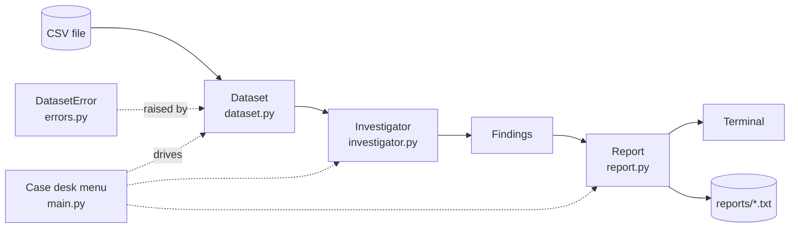

<div align="center">

# 🔍 Python Data Detective

**Every dataset has secrets. This detective finds them before your analysis does.**

A menu-driven terminal app that investigates a CSV file's data quality: missing values,
duplicate rows, invalid numbers and broken rows. It profiles every column, scores the
dataset out of 100 and writes a detective-themed case report.


</div>

---

## 🕵️ The case board

Option 5 puts every dataset in the evidence locker on trial at once:

```text
================================================================
  CASE BOARD  -  every dataset in datasets/
================================================================
  Rank  Dataset                 Rows  Score  Verdict
  1     penguins.csv             344     99  Case closed
  2     student_grades.csv       120     98  Case closed
  3     iris.csv                 150     97  Case closed
  4     tricky_addresses.csv      80     95  Case closed
  5     old_export_latin1.csv     30     92  Minor clean-up
  6     messy_sales.csv          200     83  Needs cleaning
  7     broken_rows.csv           60     27  Unreliable
  --    empty.csv                  -      -  Could not open
  --    not_really_a_csv.csv       -      -  Could not open
----------------------------------------------------------------
  empty.csv: file is empty
  not_really_a_csv.csv: doesn't look like a plain text CSV
----------------------------------------------------------------
```

> Even the famous Iris dataset doesn't get off scot-free: the detective finds
> **3 duplicate rows** in the UCI copy (lines 36 and 39 repeat line 11; line 144 repeats line 103).

## 📁 A case file

Option 3 investigates one dataset. Here is part of the report for `messy_sales.csv`:

```text
================================================================
CASE FILE #20261026-1451                   PYTHON DATA DETECTIVE
Dataset : messy_sales.csv
Opened  : 26 Oct 2026, 14:51
================================================================
[EVIDENCE]
  200 rows x 6 columns  (delimiter ',', 2 blank lines skipped)

[SUSPECTS]  columns with problems
  region        text     6 missing
  price         numeric  18 missing  8 invalid
                e.g. 'twelve' (line 12), '$15' (line 17),
                     '15.00 AUD' (line 75)
  qty           numeric  6 missing
  rating        numeric  10 missing  8 invalid
                e.g. 'N.A.' (line 41), '**' (line 59),
                     '**' (line 68)

[DUPLICATES]  10 duplicate rows
  line 79 duplicates line 51
  line 129 duplicates line 89
  ...

[COLUMN PROFILES]
  price         numeric    9.0% missing
                min 2.6  max 89.0  mean 44.2  median 40.4
  region        text       3.0% missing
                4 unique, most common 'East' (54)
  ...

[SUB-SCORES]  100 - 5 points per 1% of problem data
  Completeness  83.3  (3.3% of cells missing)
  Uniqueness    75.0  (5.0% of rows duplicated)
  Validity      89.6  (2.1% of numbers invalid)
================================================================
VERDICT: 83/100  -  Significant cleaning needed
================================================================
```

Option 4 saves exactly this text to `reports/messy_sales_report.txt`.

## ✨ What it investigates

| Check | What it catches | Example |
|---|---|---|
| **Missing values** | Blank cells and markers such as `NA`, `N/A`, `null`, `None`, `nan`, `-`, `?` | `region: 6 missing` |
| **Duplicate rows** | Exact repeats of an earlier row (ignoring stray spaces), with file line numbers | `line 79 duplicates line 51` |
| **Invalid numbers** | Text inside a numeric column | `'twelve'`, `'$15'`, `'5 stars'` |
| **Malformed rows** | Rows with too many or too few fields: reported, then trimmed or padded | `line 9: 6 fields (expected 5)` |
| **Column profiles** | Type, % missing, then min / max / mean / median, or unique count and most common value | `4 unique, most common 'East'` |

It reads real-world CSVs without crashing:
- **Delimiters:** detects `,` `;` tab and `|` automatically.
- **Encodings:** strips Excel's UTF-8 BOM, and falls back to latin-1 for old exports.
- **Awkward files:** handles quoted commas, line breaks inside quoted values, Windows line endings and blank lines.
- **Corrupted quoting:** warns when a quote is opened and never closed, instead of silently reading the rest of the file as one value.
- **Bad input:** refuses empty or binary files, and odd paths such as `?` or a stray `"`, with a friendly message instead of a traceback.

## 🧮 How the score works

Each sub-score starts at **100** and loses **5 points for every 1% of the data with that problem** (it never goes below 0):

| Sub-score | Weight | Measures |
|---|---|---|
| Completeness | 40% | cells that are missing |
| Uniqueness | 30% | rows that repeat an earlier row |
| Validity | 30% | non-numbers inside numeric columns |

| Overall | Verdict |
|---|---|
| 95–100 | 🟢 Case closed: ready for analysis |
| 85–94 | 🟡 Minor clean-up needed |
| 70–84 | 🟠 Significant cleaning needed |
| 0–69 | 🔴 Unreliable evidence: investigate before use |

A column counts as numeric when at least 80% of its filled cells are numbers.
The penalty was calibrated on the sample datasets: with plain percentages, even
`messy_sales.csv` scored 97 and walked free.

## 🚀 Quick start

```bash
git clone https://github.com/prajwalbankar/Python-Data-Detective.git
cd Python-Data-Detective/python_data_detective
python main.py        # or: python3 main.py
```

**Nothing to install:** it uses only Python's standard library (Python 3.9+). It can be run from any folder, because it finds `datasets/` and `reports/` by itself.

| Option | What it does |
|---|---|
| `1` Open a case | Pick a dataset from `datasets/`, or paste the path to any CSV (quotes are fine) |
| `2` Inspect the evidence | Size, delimiter, encoding, column names and a preview table |
| `3` Run the investigation | The full case report and quality score |
| `4` Save the case report | Writes `reports/<dataset>_report.txt` |
| `5` Investigate ALL | Ranks every dataset on the case board, and can save every report |
| `0` Close the office | Quit (Ctrl+C also exits cleanly) |

## 🗄️ The evidence locker

Nine sample datasets, from spotless to sabotaged:

| Dataset | Source | What it tests | Score |
|---|---|---|---|
| `penguins.csv` | Real: Palmer Penguins | 19 genuine `NA` values | 99 |
| `student_grades.csv` | AI-generated | a few blanks, one duplicate | 98 |
| `iris.csv` | Real: UCI Iris | the classic, with 3 hidden duplicates | 97 |
| `tricky_addresses.csv` | AI-generated | `;` delimiter, Excel BOM, quoted commas and line breaks | 95 |
| `old_export_latin1.csv` | AI-generated | latin-1 encoding (`José`, `São Paulo`) | 92 |
| `messy_sales.csv` | AI-generated | every missing marker, invalid numbers, duplicates, CRLF | 83 |
| `broken_rows.csv` | AI-generated | ragged rows, 25% duplicates, a blank column name | 27 |
| `empty.csv` | AI-generated | an empty file | refused |
| `not_really_a_csv.csv` | AI-generated | binary data in disguise | refused |

The AI-generated files come from [`tools/make_datasets.py`](python_data_detective/tools/make_datasets.py)
(fixed seed). It also prints an **answer key** of exactly what it injected, which the tests check the detective against.

## 🏗️ How it's built



Each module has one job, and data flows in one direction:

```text
python_data_detective/
├── main.py            # RUN THIS: menu, input and program flow
├── dataset.py         # Dataset: reads and tidies a CSV (encoding, delimiter, ragged rows)
├── investigator.py    # Investigator, Findings, ColumnProfile: checks, profiles and scores
├── report.py          # Report: every piece of text the user reads
├── errors.py          # DatasetError -> UnreadableFileError, EmptyDatasetError
├── datasets/          # the evidence locker (9 sample CSVs)
├── tools/
│   └── make_datasets.py   # seeded generator plus answer key (not needed to run)
└── README.txt         # plain-text guide for markers
```

**Design rules:**
- `main.py` never formats text, and `report.py` never asks for input.
- The terminal and the saved report always show identical text.
- The program's own output is plain ASCII, and no line is wider than 64 characters, so it looks right in Ed's web terminal, Windows cmd and on a projector.
- Expected problems raise `DatasetError` subclasses, which the menu turns into friendly messages. Genuine bugs are never hidden.

## ✅ Testing

```bash
python -m unittest discover -s dev_tests -v
```

There are **77 tests** in [`dev_tests/`](dev_tests). They include:
- **An answer-key integration test:** the generator injects a known number of each problem, and the detective must report exactly those counts and line numbers.
- **Real-data checks:** Iris and Penguins against hand-counted duplicates and missing values.
- **Situations a marker might actually hit:** running from another folder, Windows paths with spaces pasted in quotes, CRLF files, single-column CSVs, and Ctrl+C or Ctrl+D at every prompt.
- **A documentation check:** every module, class and function must have a docstring and type hints.

## 📚 Concepts on show

**From COMP9001:** classes and objects (instance and static methods, class variables, `__str__`), file I/O, exception handling (a custom exception hierarchy, `raise`, `try/except/finally`), advanced flow control (`break`, `continue`, early `return`, multiple return values), containers, functions and modules.

**Beyond the lectures:** the `csv` module's `Sniffer`, `io.StringIO`, encodings (`utf-8-sig`, latin-1), `collections.Counter`, `statistics`, `math.isfinite`, `datetime` formatting, `sorted(key=lambda ...)`, tuples as dictionary keys, f-string format specs, `__file__`-relative paths, `@staticmethod`, `typing.Optional`, and `unittest` with `mock` and `subprocess`.

## 📖 Design documents

The whole project was designed before it was coded:
- [Design spec](docs/2026-10-26-python-data-detective-design.md): requirements, rules, scoring, every screen, error handling.
- [Implementation plan](docs/2026-10-26-python-data-detective-plan.md): ten test-first tasks.

## 🙏 Credits

- **Iris:** Fisher, R. A. (1936). *Iris* [Dataset]. UCI Machine Learning Repository. https://doi.org/10.24432/C56C76 (CC BY 4.0; a header row was added).
- **Palmer Penguins:** Horst, A. M., Hill, A. P., & Gorman, K. B. (2020). *palmerpenguins*. https://allisonhorst.github.io/palmerpenguins/ (CC0). Data collected by Dr. Kristen Gorman and the Palmer Station LTER.
- **AI use:** this project was built with the help of Claude (Anthropic), which assisted with planning the design, writing and testing the code, and drafting the documentation. The seven AI-generated datasets were made by `tools/make_datasets.py`, which was written with Claude's help.

## 👤 Author

**Prajwal Bankar**: COMP9001 *Introduction to Programming* final project, University of Sydney, 2026.
