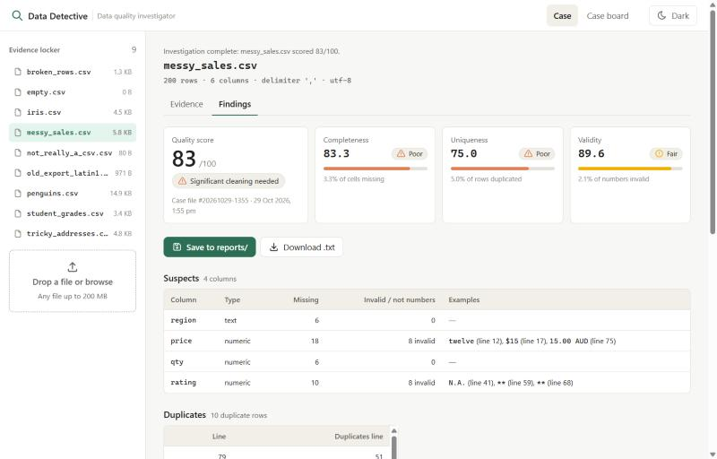
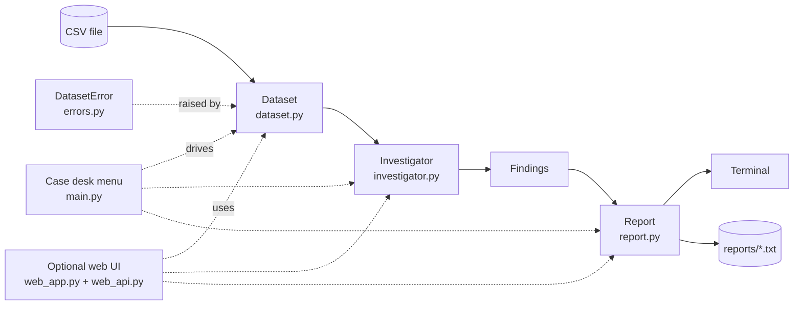

<div align="center">

# 🔍 Python Data Detective

**Every dataset has secrets. This detective finds them before your analysis does.**

A menu-driven terminal app that investigates a CSV file's data quality: missing values,
duplicate rows, invalid numbers and broken rows. It profiles every column, scores the
dataset out of 100 and writes a detective-themed case report.

**GitHub repository: [github.com/prajwalbankar/Python-Data-Detective](https://github.com/prajwalbankar/Python-Data-Detective)**


</div>

---

## 🕵️ The case board

Option 5 puts every dataset in the evidence locker on trial at once:

```text
================================================================
  CASE BOARD  -  every dataset in datasets/
================================================================
  Rank  Dataset                     Rows  Score  Verdict
  1     penguins.csv                 344     99  Case closed
  2     student_grades.csv           120     98  Case closed
  3     iris.csv                     150     97  Case closed
  4     tricky_addresses.csv          80     95  Case closed
  5     old_export_latin1.csv         30     92  Minor clean-up
  6     messy_sales.csv              200     83  Needs cleaning
  7     broken_rows.csv               60     13  Unreliable
  --    empty.csv                      -      -  Could not open
  --    not_really_a_csv.csv           -      -  Could not open
----------------------------------------------------------------
  empty.csv: file is empty
  not_really_a_csv.csv: this is a PNG image, not a CSV file
----------------------------------------------------------------
```

> Even the famous Iris dataset doesn't get off scot-free: the detective finds
> **3 duplicate rows** in the UCI copy (lines 36 and 39 repeat line 11; line 144 repeats line 103).

## 📁 A case file

Option 3 investigates one dataset. Here is part of the report for `messy_sales.csv`:

```text
================================================================
CASE FILE #20261026-1451                   PYTHON DATA DETECTIVE
Dataset : messy_sales.csv
Opened  : 26 Oct 2026, 14:51
================================================================
[EVIDENCE]
  200 rows x 6 columns  (delimiter ',', 2 blank lines skipped)

[SUSPECTS]  columns with problems
  region        text     6 missing
  price         numeric  18 missing  8 invalid
                e.g. 'twelve' (line 12), '$15' (line 17),
                     '15.00 AUD' (line 75)
  qty           numeric  6 missing
  rating        numeric  10 missing  8 invalid
                e.g. 'N.A.' (line 41), '**' (line 59),
                     '**' (line 68)

[DUPLICATES]  10 duplicate rows
  line 79 duplicates line 51
  line 129 duplicates line 89
  ...

[COLUMN PROFILES]
  price         numeric    9.0% missing
                min 2.6  max 89.0  mean 44.2  median 40.4
  region        text       3.0% missing
                4 unique, most common 'East' (54)
  ...

[SUB-SCORES]  100 - 5 points per 1% of problem data
  Completeness   83.3  (3.3% of cells missing)
  Uniqueness     75.0  (5.0% of rows duplicated)
  Validity       89.6  (2.1% of numbers invalid)
================================================================
VERDICT: 83/100  -  Significant cleaning needed
================================================================
```

Option 4 saves exactly this text to `reports/messy_sales_report.txt`.

## ✨ What it investigates

| Check | What it catches | Example |
|---|---|---|
| **Missing values** | Blank cells and markers such as `NA`, `N/A`, `null`, `None`, `nan`, `-`, `?` | `region: 6 missing` |
| **Duplicate rows** | Exact repeats of an earlier row (ignoring stray spaces), with file line numbers | `line 79 duplicates line 51` |
| **Invalid numbers** | Text inside a numeric column | `'twelve'`, `'$15'`, `'5 stars'` |
| **Malformed rows** | Rows with too many or too few fields: reported, then trimmed or padded | `line 9: 6 fields (expected 5)` |
| **Column profiles** | Type, % missing, then min / max / mean / median, or unique count and most common value | `4 unique, most common 'East'` |

It reads real-world CSVs without crashing:
- **Delimiters:** detects `,` `;` tab and `|` automatically.
- **Encodings:** UTF-8 (including Excel's BOM), UTF-16 (PowerShell, Excel "Unicode Text"), Windows cp1252 (Excel's curly quotes and €) and latin-1 for old exports.
- **Export quirks:** ignores trailing delimiters (`a,b,` / `1,2,`) instead of inventing an empty column.
- **Suspicious structure:** warns when the "header" looks like data (a file with no header row) or when a title line sits above the real header.
- **Notes above the header:** skips the notes and blank lines that downloads such as the World Bank's put above the header, and says so. It also follows Excel's `sep=;` first line.
- **Awkward files:** handles quoted commas, line breaks inside quoted values, Windows line endings and blank lines.
- **Corrupted quoting:** warns when a quote is opened and never closed, instead of silently reading the rest of the file as one value.
- **Not a CSV at all?** It names the file instead of misreading it: *"this is a PNG image"*, *"…an Excel workbook (.xlsx) – open it in Excel and use Save As > CSV"*, or *"this looks like JSON data"*. This covers images, audio, video, Office files, archives, PDFs, databases, programs, JSON, XML/HTML, SQL and Markdown.
- **Bad input:** refuses empty files, device names such as `CON`, and odd paths such as `?` or a stray `"`, and reports a file that's too big for memory, all with a friendly message instead of a traceback. It also accepts `~` and paths dragged into a macOS terminal.
- **Awkward data:** handles cells of any size (e.g. base64 images), files mixing UTF-8 and Windows encodings, and lists the stray values in a column that's mostly numbers.

## 🧮 How the score works

Each sub-score starts at **100** and loses **5 points for every 1% of the data with that problem** (it never goes below 0):

| Sub-score | Weight | Measures |
|---|---|---|
| Completeness | 40% | cells that are missing |
| Uniqueness | 30% | rows that repeat an earlier row |
| Validity | 30% | non-numbers inside numeric columns, plus rows with the wrong number of fields |

| Overall | Verdict |
|---|---|
| 95–100 | 🟢 Case closed: ready for analysis |
| 85–94 | 🟡 Minor clean-up needed |
| 70–84 | 🟠 Significant cleaning needed |
| 0–69 | 🔴 Unreliable evidence: investigate before use |

A column counts as numeric when at least 80% of its filled cells are numbers.
The penalty was calibrated on the sample datasets: with plain percentages, even
`messy_sales.csv` scored 97 and walked free.

## 🚀 Quick start

**1. Get the code.** Download it from [the GitHub repository](https://github.com/prajwalbankar/Python-Data-Detective) with **Code → Download ZIP** and unzip it (no git needed), or clone it:

```bash
git clone https://github.com/prajwalbankar/Python-Data-Detective.git
```

**2. Run it** from the `python_data_detective` folder:

```bash
cd Python-Data-Detective/python_data_detective
python main.py        # Windows (or: py main.py)
python3 main.py       # macOS, Linux and Ed
```

It can be run from any folder, because it finds `datasets/` and `reports/` by itself.

### Requirements

- **Python 3.9 or newer**, on Windows, macOS or Linux, or in Ed's terminal. Nothing else.
- **No libraries to install:** only Python's standard library is used, so there is no `pip install`, no extra software and no internet connection needed. Everything the program needs is inside the `python_data_detective` folder.
- **Checked for crashes:**
  - the full test suite passes on Python 3.10 and 3.11 on Windows, with deprecation warnings treated as errors;
  - every file passes Python 3.9's grammar check;
  - no feature that is deprecated or removed up to Python 3.15 is used;
  - non-English and emoji data prints safely even when output isn't a normal terminal, and in UTF-8 mode (the default from Python 3.15).
- The optional web UI needs only the same Python and any web browser. Its page loads nothing from the internet.

| Option | What it does |
|---|---|
| `1` Open a case | Pick a dataset from `datasets/`, or paste the path to any CSV (quotes are fine) |
| `2` Inspect the evidence | Size, delimiter, encoding, column names and a preview table |
| `3` Run the investigation | The full case report and quality score |
| `4` Save the case report | Writes `reports/<dataset>_report.txt` |
| `5` Investigate ALL | Ranks every dataset on the case board, and can save every report |
| `0` Close the office | Quit (Ctrl+C also exits cleanly) |

## 🖥️ Web UI (optional)

For demonstrations, the same detective also runs as a local web page:

```bash
python web_app.py               # opens http://127.0.0.1:8000 in your browser
python web_app.py --no-browser  # just print the address
```



Every menu option is there: pick a dataset from the evidence locker or drop in any file, inspect the evidence,
run the investigation (score, sub-scores, suspects, duplicates, malformed rows and sortable column profiles),
save the report to `reports/` or download it, and rank every dataset on the case board. It is still standard
library only: `http.server` serves a small JSON API (`web_api.py`) over the same classes the terminal uses, and the
page is plain HTML, CSS and JavaScript with light and dark themes. It listens on this computer only
(`127.0.0.1`); press Ctrl+C to stop it. Ed can't run it, so the terminal program stays the main version.

## 🗄️ The evidence locker

Nine sample datasets, from spotless to sabotaged:

| Dataset | Source | What it tests | Score |
|---|---|---|---|
| `penguins.csv` | Real: Palmer Penguins | 19 genuine `NA` values | 99 |
| `student_grades.csv` | AI-generated | a few blanks, one duplicate | 98 |
| `iris.csv` | Real: UCI Iris | the classic, with 3 hidden duplicates | 97 |
| `tricky_addresses.csv` | AI-generated | `;` delimiter, Excel BOM, quoted commas and line breaks | 95 |
| `old_export_latin1.csv` | AI-generated | latin-1 encoding (`José`, `São Paulo`) | 92 |
| `messy_sales.csv` | AI-generated | every missing marker, invalid numbers, duplicates, CRLF | 83 |
| `broken_rows.csv` | AI-generated | ragged rows, 25% duplicates, a blank column name | 13 |
| `empty.csv` | AI-generated | an empty file | refused |
| `not_really_a_csv.csv` | AI-generated | binary data in disguise | refused |

The AI-generated files come from [`tools/make_datasets.py`](python_data_detective/tools/make_datasets.py)
(fixed seed). It also prints an **answer key** of exactly what it injected, which the tests check the detective against.

## 🏗️ How it's built



Each module has one job, and data flows in one direction:

```text
python_data_detective/
├── main.py            # RUN THIS: menu, input and program flow
├── dataset.py         # Dataset: reads and tidies a CSV (encoding, delimiter, ragged rows)
├── investigator.py    # Investigator, Findings, ColumnProfile: checks, profiles and scores
├── report.py          # Report: every piece of text the user reads
├── errors.py          # DatasetError -> UnreadableFileError, EmptyDatasetError
├── file_types.py      # recognises non-CSV files (images, Excel, PDF, JSON...)
├── web_app.py         # optional web UI: the local server
├── web_api.py         # the web UI's JSON API, over the same classes
├── web/               # index.html, style.css, app.js
├── datasets/          # the evidence locker (9 sample CSVs)
├── tools/
│   └── make_datasets.py   # seeded generator plus answer key (not needed to run)
├── README.txt         # plain-text guide for markers
└── AI_Acknowledgement.txt  # how AI was used in this project
```

Only `python_data_detective/` is needed to run the program. The rest of the repository is for development:
`dev_tests/` (the unit tests), `stress_tests/` (the stress-test scripts) and `docs/` (design documents and the robustness report).

**Design rules:**
- `main.py` never formats text, and `report.py` never asks for input.
- The terminal and the saved report always show identical text.
- The program's own output is plain ASCII, and no line is wider than 64 characters, so it looks right in Ed's web terminal, Windows cmd and on a projector.
- Expected problems raise `DatasetError` subclasses, which the menu turns into friendly messages. Genuine bugs are never hidden.

## ✅ Testing

```bash
python -m unittest discover -s dev_tests -v
```

There are **161 tests** in [`dev_tests/`](dev_tests), and they need only the standard library too. The program was also **stress-tested on 60 kinds of input**, from images, audio, Excel workbooks and JSON to a 1,000,000-row CSV, **plus 20 real-world layouts**: Titanic-style quoting, World Bank downloads, Excel's `sep=;` line, old Mac line endings and numbers near the float limit. Both the terminal program and the web UI were checked. See the [robustness report](docs/robustness-report.md); it's reproducible with `stress_tests/`. Its optional memory measurement uses `psutil` if it's installed and is skipped otherwise; the program itself never needs it. The tests include:
- **Robustness fuzzing:** 400 randomly generated broken CSV files (mixed delimiters, encodings, ragged rows, stray quotes, NUL bytes, emoji) and 150 random typing sessions at every prompt. Nothing may end in a traceback or print a line wider than 64 characters.
- **An edge-case matrix** of 34 awkward files, from 300 columns and 200 KB fields to CR-only line endings and UTF-16.
- **An answer-key integration test:** the generator injects a known number of each problem, and the detective must report exactly those counts and line numbers.
- **Real-data checks:** Iris and Penguins against hand-counted duplicates and missing values.
- **Situations a marker might actually hit:** running from another folder, Windows paths with spaces pasted in quotes, CRLF files, single-column CSVs, and Ctrl+C or Ctrl+D at every prompt.
- **A documentation check:** every module, class and function must have a docstring and type hints.

## 📚 Concepts on show

**From COMP9001:** classes and objects (instance and static methods, class variables, `__str__`), file I/O, exception handling (a custom exception hierarchy, `raise`, `try/except/finally`), advanced flow control (`break`, `continue`, early `return`, multiple return values), containers, functions and modules.

**Beyond the lectures:** the `csv` module's `Sniffer`, `io.StringIO`, encodings (`utf-8-sig`, UTF-16 via `codecs` BOMs, cp1252, latin-1), file "magic numbers", `json`, `textwrap`, `collections.Counter`, `statistics`, `math.isfinite`, `datetime` formatting, `sorted(key=lambda ...)`, tuples as dictionary keys, f-string format specs, `__file__`-relative paths, `@staticmethod`, `typing.Optional`, and `unittest` with `mock` and `subprocess`. The optional web UI adds `http.server`, `threading.Lock`, `urllib.parse`, `tempfile`, `webbrowser`, and a page in plain HTML, CSS and JavaScript.

## 📖 Design documents

The whole project was designed before it was coded:
- [Design spec](docs/2026-10-26-python-data-detective-design.md): requirements, rules, scoring, every screen, error handling.
- [Implementation plan](docs/2026-10-26-python-data-detective-plan.md): ten test-first tasks.
- [Web UI spec](docs/2026-10-29-web-ui-design.md) and [plan](docs/2026-10-29-web-ui-plan.md): the optional web page.

## 🙏 Credits

- **Iris:** Fisher, R. A. (1936). *Iris* [Dataset]. UCI Machine Learning Repository. https://doi.org/10.24432/C56C76 (CC BY 4.0; a header row was added).
- **Palmer Penguins:** Horst, A. M., Hill, A. P., & Gorman, K. B. (2020). *palmerpenguins*. https://allisonhorst.github.io/palmerpenguins/ (CC0). Data collected by Dr. Kristen Gorman and the Palmer Station LTER.
- **AI use:** this project was built with the help of Claude (Anthropic), which assisted with planning the design, writing and testing the code, and drafting the documentation. The seven AI-generated datasets were made by `tools/make_datasets.py`, which was written with Claude's help. See [`AI_Acknowledgement.txt`](python_data_detective/AI_Acknowledgement.txt).

## 👤 Author

**Prajwal Bankar**: COMP9001 *Introduction to Programming* final project, University of Sydney, 2026.
